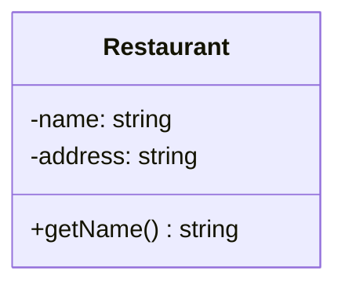
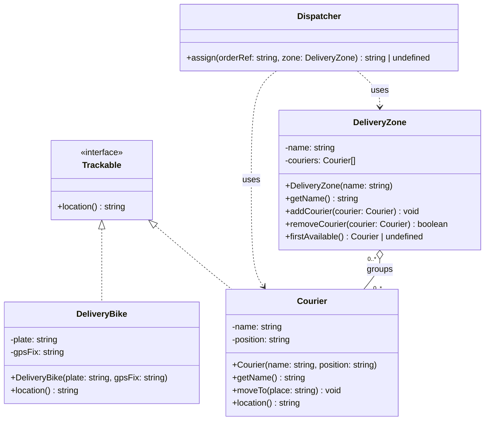
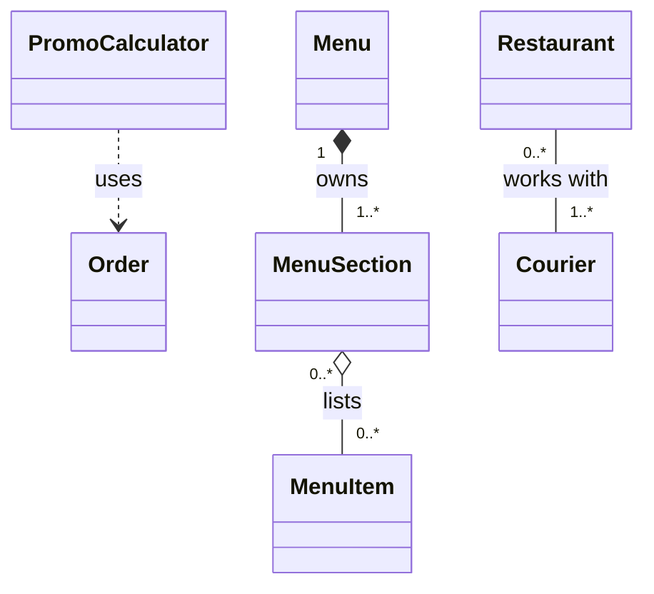
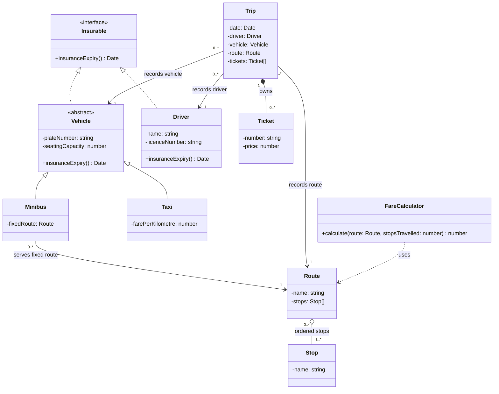

# Lab 5 — UML, Part 1: Class Diagrams

Object-Oriented Programming — DAUST Fall 2026

Constructors are omitted from diagram boxes unless shown explicitly. Predictions below were recorded before the corresponding executions. The submitted code is the final version after Step 15.

## Step 1



## Step 2

The private fields and public getter are implemented in `order.ts`. Checkpoint output:

```text
Awa
```

## Step 3

`Dish` and `Drink` extend the abstract `MenuItem` class and implement its protected `category()` operation. Checkpoint output:

```text
Awa
Thieboudienne (dish) — 2500 FCFA
Yassa poulet (spicy dish) — 2000 FCFA
Bissap (drink, 33 cl) — 500 FCFA
```

## Step 4

**Prediction 1 — before execution**

| Line | Will it be underlined in red? Which symbol tells you? | The error message |
|---|---|---|
| (a) | Yes. `<<abstract>>` on `MenuItem` forbids direct instantiation. | `Cannot create an instance of an abstract class.` (TS2511) |
| (b) | Yes. `#` marks `category()` as protected. | `Property 'category' is protected and only accessible within class 'Dish' and its subclasses.` (TS2445) |
| (c) | Yes. `-` marks `Customer.name` as private. | `Property 'name' is private and only accessible within class 'Customer'.` (TS2341) |

The messages above are actual TypeScript compiler diagnostics for the three temporary lines. Those lines were then removed, restoring the output of Checkpoint 3.

## Step 5

**Question 1**

| Item | Answer | Multiplicity and the end where it appears |
|---|---|---|
| (a) Can a customer exist without placing an order? | Yes. | `0..*`, at the `Order` end: a customer may have zero orders. |
| (b) Can one order belong to two customers? | No. | `1`, at the `Customer` end: each order has exactly one customer. |
| (c) Can Bissap appear in many order lines? | Yes. | `0..*`, at the `OrderLine` end: one menu item may be referenced by many lines. |
| (d) Can one order line refer to two menu items? | No. | `1`, at the `MenuItem` end: each line refers to exactly one item. |

## Step 6

**Question 2**

A list of menu items alone has no place to store the quantity belonging to each order entry. Adding a quantity field to `MenuItem` would also be wrong: Awa and Fatou may order different quantities of the same shared item. `OrderLine` keeps the item and its order-specific quantity together.

Checkpoint: two Thieboudienne give a subtotal of `5000`.

## Step 7

**Question 3**

An `Order` owns and creates its `OrderLine` parts, whereas a line only refers to a `MenuItem` that exists independently and may be shared by other lines.

The standalone Step 6 line test was removed. Checkpoint output:

```text
Awa
Thieboudienne (dish) — 2500 FCFA
Yassa poulet (spicy dish) — 2000 FCFA
Bissap (drink, 33 cl) — 500 FCFA
true true false false
2 6500
Awa: 2 lines, 6500 FCFA
```

## Step 8

**Question 4**

**(a)** The code is correct. The association specifies which objects are related and how many may be related; it does not require both classes to store references to each other. Each `Order` stores one `Customer`, while `Customer` does not need an `orders` collection. The relationship can be implemented in one direction.

**(b)** A newly created order has zero lines, so a diagram intended to describe every permitted code state is too restrictive at `1..*`. The constructor is reasonable for an order being built. Change the multiplicity at the `OrderLine` end to `0..*`; alternatively, require an initial valid line in the constructor. I choose the diagram change so that empty draft orders are represented. This multiplicity observation still applies after the composition repair in Step 15.

## Part B diagram



**Step 12 — Question 7: code evidence for all five relationships**

| Relationship | Line number in `dispatch.ts` | That line of code |
|---|---|---|
| `Courier` realizes `Trackable` | 5 | `class Courier implements Trackable {` |
| `DeliveryBike` realizes `Trackable` | 27 | `class DeliveryBike implements Trackable {` |
| `DeliveryZone` aggregates `Courier` | 43 | `private couriers: Courier[] = [];` |
| `Dispatcher` depends on `DeliveryZone` | 70 | `assign(orderRef: string, zone: DeliveryZone): string \| undefined {` |
| `Dispatcher` depends on `Courier` | 71 | `const courier = zone.firstAvailable();` |

For the last row, `firstAvailable()` returns `Courier | undefined`; after the undefined check, `assign()` uses the courier through `getName()` without retaining it.

## Step 9

Both concrete classes realize the `Trackable` interface. Checkpoint output:

```text
Plateau
DK-1234 at 14.67N 17.43W
```

## Step 10

**Prediction 2 — before execution**

The two new output lines will be:

```text
Moussa
undefined Moussa Médina
```

**Question 5**

`plateau.removeCourier(moussa);` followed by `medina.addCourier(moussa);` shows that the same courier can be moved between zones. The later calls `moussa.moveTo("Médina")` and `moussa.location()` show that he still exists and works after removal from Plateau. He is an independent object created before either zone, rather than a part whose lifetime belongs to one zone. Aggregation fits this model.

The multiplicities are `0..*` at both ends: a zone may contain no couriers or many, and the code does not prevent adding the same courier to more than one zone simultaneously. Removing him from Plateau in this particular test is not an enforced exclusivity rule. Observed output matched the prediction.

## Step 11

**Question 6**

`Dispatcher` would need to retain a structural reference, such as a private `zone: DeliveryZone` field, to justify a solid association. Here `zone` is only a parameter and `courier` is only a local variable, so the dependencies point to `DeliveryZone` and `Courier`.

The two new output lines were:

```text
Moussa takes order #12 in Médina
undefined
```

## Step 13

**Prediction 3 — before execution**

The two new output lines will be:

```text
6500 5000
26500 25000
```

Fatou's order and Awa's order hold references to the same first `OrderLine` object. Changing that object's quantity from 2 to 10 changes the subtotal seen by both orders, even though Fatou's order itself was never edited. The observed output matched the prediction.

## Step 14

**Question 8**

Exclusive ownership is broken: the same line now belongs to two orders, contradicting the `1` at the `Order` end of the composition.

- `getLines()` hands parts **out** by returning the actual internal array and its mutable line objects.
- `addExistingLine()` takes parts **in** by accepting a line created elsewhere, without creating an independently owned replacement.

Together, the methods permit shared parts that the filled diamond promises cannot be shared.

## Step 15

`copyFrom()` creates fresh order lines while sharing only the independent menu items. `changeQuantity()` rejects missing or non-integer indices and invalid quantities without changing the order. The shallow snapshot of `other.lines` also makes copying an order into itself finite; its line objects are read only to create new ones. The two unsafe `Order` methods and the Step 13 test were removed. Checkpoint output ends with:

```text
6500 6500
true false
26500 6500
```

## Step 16

**Question 9**

| Inheritance test | Application to `Courier extends Customer` |
|---|---|
| Is-a | **Fails first.** Being a courier does not make someone a customer in this model. Sharing contact attributes does not establish a specialization. A person may hold both roles, but the roles are different. |
| Substitution | A courier object should not automatically be usable wherever a customer is expected, for example as the customer placing an order, merely because it delivers orders. The roles have different meanings and responsibilities. |
| Stability | A person can start or stop being a customer or courier independently; tying the roles through inheritance would make unrelated changes affect each other. |

Keep `Courier` and `Customer` as separate classes. If delivery information is needed, draw an association from `Courier` to `Order`, labelled `delivers`. Shared contact details can be held in a separate contact-information object used by each role, rather than justified by a triangle between the roles.

## Step 17

**Question 10**



| # | Relationship | Reason, in one sentence |
|---|---|---|
| 1 | Dependency | `PromoCalculator` uses an `Order` during `apply()` and retains nothing. |
| 2 | Composition | A `Menu` creates and owns its `MenuSection` parts, which have no independent meaning outside that menu. |
| 3 | Aggregation | Sections group independent menu items, and Bissap can be shared between several sections. |
| 4 | Association | Restaurants and couriers work together without a whole–part or lifetime-ownership relationship. |

Multiplicity choices: a menu has at least one section, and each section has exactly one owning menu. A section may be empty and an item may appear in zero or many sections. Each restaurant works with one or more couriers; a courier may work with zero or many restaurants. These lower bounds allow unlisted items and couriers awaiting work, without imposing exclusivity.

## Step 18

The working diagram started with nine class boxes: `Vehicle`, `Minibus`, `Taxi`, `Route`, `Stop`, `Driver`, `Trip`, `Ticket` and `FareCalculator`. Values such such as plate numbers, dates and prices are attributes. `Stop.name` identifies stops such as Colobane; route names, driver names and stop names are separate values belonging to their respective objects. `FareCalculator.calculate(route: Route, stopsTravelled: number): number` is the requested operation. Reference fields are the same links later drawn as relationships, rather than additional domain classes.

## Step 19

`Vehicle` is abstract, with `Minibus` and `Taxi` as its subclasses. The `Insurable` interface supplies the shared `insuranceExpiry(): Date` contract; `Vehicle` and `Driver` realize it without inheriting from each other. Minibuses and taxis inherit that vehicle operation. The vehicle kinds are intended to be complete and disjoint: each vehicle is exactly one of the two kinds.

## Step 20

Each trip records exactly one driver, one vehicle and one route. Each of those objects may participate in zero or many trips, allowing registration before the first trip. Each minibus serves exactly one fixed route, and a route may be served by zero or many minibuses. No direct `Driver`–`Vehicle` association is drawn: `Trip` records their dated assignment. For a minibus trip, the recorded route must equal that minibus’s fixed route.

## Step 21

A trip owns its tickets by composition; a route aggregates an ordered list of shared stops; and `FareCalculator` depends on `Route` without retaining it. A trip may have zero tickets before sales start. Each ticket has exactly one owning trip. I model an operational route as having at least one stop; the requirements do not specify that lower bound explicitly. A stop may be registered before any route uses it. The first complete draft was preserved before review.

## Part E — first draft



## Part E — final


**Step 22 — Question 11**

| Classes | Relationship | Requirement sentence that justifies it |
|---|---|---|
| `Minibus`, `Vehicle` | Generalization | “Each vehicle is either a minibus (which serves one fixed route) or a taxi (which has a fare per kilometre).” |
| `Taxi`, `Vehicle` | Generalization | “Each vehicle is either a minibus (which serves one fixed route) or a taxi (which has a fare per kilometre).” |
| `Vehicle`, `Insurable` | Realization | “Vehicles and drivers must both be able to report insuranceExpiry(): Date. They are not the same kind of thing.” |
| `Driver`, `Insurable` | Realization | “Vehicles and drivers must both be able to report insuranceExpiry(): Date. They are not the same kind of thing.” |
| `Minibus`, `Route` | Association: each minibus has one route; a route may serve many minibuses | “Each vehicle is either a minibus (which serves one fixed route) or a taxi (which has a fare per kilometre).” |
| `Trip`, `Driver` | Association: one driver per trip; zero or many trips per driver | “A trip records a date, the driver, the vehicle and the route. A driver makes many trips, and so does a vehicle.” |
| `Trip`, `Vehicle` | Association: one vehicle per trip; zero or many trips per vehicle | “A trip records a date, the driver, the vehicle and the route. A driver makes many trips, and so does a vehicle.” |
| `Trip`, `Route` | Association: one route per trip; zero or many trips per route | “A trip records a date, the driver, the vehicle and the route.” |
| `Trip`, `Ticket` | Composition: one owning trip per ticket; zero or many tickets per trip | “During a trip, tickets are sold. A ticket has a number and a price, belongs to exactly one trip, and means nothing without it.” |
| `Route`, `Stop` | Aggregation: ordered, shared stops | “A route has a name and an ordered list of stops. The same stop, for example Colobane, is used by several routes.” |
| `FareCalculator`, `Route` | Dependency | “A fare calculator computes a ticket price from a route and a number of stops travelled. It keeps nothing.” |

**(a)** The hardest relationship was `Route`–`Stop`. An ordered list can look like composition, but the same stop belongs to several routes and exists independently, so I chose aggregation with an `ordered stops` label.

**(b)** I made no changes after the first complete draft. I checked that the filled diamond is only on `Trip`–`Ticket`, never on shared stops, and that every association has two multiplicities with the `1` at the correct end. I also checked both vehicle generalizations, both interface realizations, the absence of a direct driver–vehicle link, all required attributes, the route dependency, and the ordered-stop label. The one-stop minimum is an explicit modelling assumption, not an extra stated requirement.

The final diagram has eleven relationship lines, each justified by one row above.

## Final verification

All 22 checkpoints were completed in order. Both final TypeScript files passed the supplied strict configuration and ran directly with `node`. All five Mermaid blocks in this file were checked in Mermaid Live Editor and rendered successfully. Rendering on the destination GitHub repository still needs to be checked after upload.

Final `node order.ts` output:

```text
Awa
Thieboudienne (dish) — 2500 FCFA
Yassa poulet (spicy dish) — 2000 FCFA
Bissap (drink, 33 cl) — 500 FCFA
true true false false
2 6500
Awa: 2 lines, 6500 FCFA
6500 6500
true false
26500 6500
```

Final `node dispatch.ts` output:

```text
Plateau
DK-1234 at 14.67N 17.43W
Moussa
undefined Moussa Médina
Moussa takes order #12 in Médina
undefined
```
